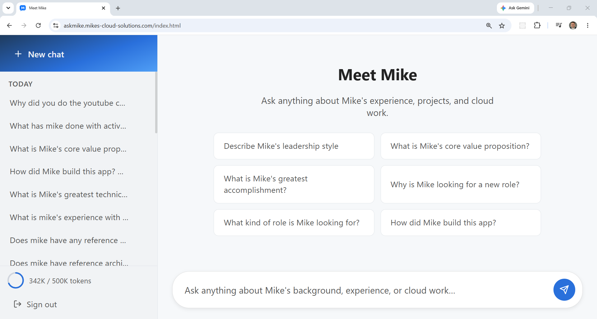

# Meet Mike on AWS: a Serverless RAG Interview Assistant with Bedrock

**Meet Mike** is a ChatGPT-style assistant that answers questions about
Mike Monaco's background, experience, cloud portfolio and career history,
for visitors and hiring managers. Users sign in with **Cognito** and ask
questions in a chat app on **S3**; an **SQS**-driven **Lambda** worker
answers with retrieval-augmented generation on **Amazon Bedrock**: Titan
Embeddings v2 finds the most relevant chunks of the corpus and Claude Haiku
writes the answer, with the last few turns of the conversation as context.
Everything is serverless.

The later [aws-ask-mike](https://github.com/mamonaco1973/aws-ask-mike)
builds on this one with CloudFront and a portfolio-focused corpus.



| Piece | Where | Role |
|---|---|---|
| **rag-app-&lt;hex&gt;** | S3 | public bucket with the chat app |
| **rag-app user pool** | Cognito, us-east-1 | Hosted UI with the authorization code flow |
| **rag-api-&lt;hex&gt;** | API Gateway + Lambda | HTTP API with a Cognito JWT authorizer; one Python 3.11 function (10 s) serving every route |
| **rag-query-requests-&lt;hex&gt;** | SQS | 6 min visibility, 4 day retention; one receive, then `rag-query-requests-dlq` (14 days) |
| **rag-worker-&lt;hex&gt;** | Lambda | Python 3.11 with a numpy layer, 512 MB, 300 s; triggered one message at a time |
| **rag-data-&lt;hex&gt;** | S3 | `corpus/chunks.json` and `corpus/embeddings.npy`, plus each query's question, answer and sources |
| **DynamoDB** | us-east-1 | single table: `USER#USAGE`, `CONV#` and `QUERY#` items |
| **Bedrock** | us-east-1 | Claude Haiku 4.5 (inference profile `us.anthropic.claude-haiku-4-5-20251001-v1:0`) and `amazon.titan-embed-text-v2:0` |

## Architecture

<picture>
  <source media="(prefers-color-scheme: dark)" srcset="architecture-dark.svg">
  
</picture>

Regenerate with `python3 make_diagram.py`.

- **`01-core/`**: Cognito, the API and both functions (code in `code/`),
  the queues, the table, both buckets, and the numpy layer.
- **`02-webapp/`**: the chat app (`index.html`, `callback.html`).
- **`03-ingest/`**: `ingest.py` and the local `.txt` sources: resume,
  background facts, and one file per common interview question. It runs on
  your machine, not in AWS.

## How a question is answered

1. The app posts the question to `/conversations/{conv_id}/queries`. The API
   function checks the user's token budget, writes `question.txt` to S3,
   records the query as `pending`, and queues it.
2. The worker loads the corpus from S3, embeds the question with Titan v2,
   and takes the 10 closest chunks by cosine similarity.
3. It adds the last 5 Q&A pairs from the conversation, asks Claude Haiku,
   writes `answer.txt` and `sources.json` to S3, marks the query `complete`,
   and adds the tokens to the user's usage; on an error it marks the query
   `failed`.
4. The app polls the query until it's done and shows the answer.

The corpus comes from `ingest.py`: the local `.txt` files (each on one topic
so retrieval is precise), the README.md and CLAUDE.md of every public
`mamonaco1973/*` repo, and the YouTube channel's video descriptions.

## What you can ask

- "Tell me about yourself" / career overview
- "Why are you looking for a new role?"
- "What is your greatest technical accomplishment?"
- "Tell me about Mike's pharma experience"
- "How does Mike approach a cloud migration engagement?"
- "What is Mike's leadership style?"
- "Tell me about running RStudio in the cloud"
- "Tell me about Active Directory in the cloud"
- "How many YouTube subscribers does Mike have?"
- "What is Mike looking for in his next role?"

## API

All routes need `Authorization: Bearer <Cognito JWT>`.

### Conversations

| Method | Path | Purpose |
|--------|------|---------|
| POST | `/conversations` | Create a new conversation |
| GET | `/conversations` | List all conversations (newest first) |
| DELETE | `/conversations/{conv_id}` | Delete conversation and all queries |

### Queries

| Method | Path | Purpose |
|--------|------|---------|
| POST | `/conversations/{conv_id}/queries` | Submit a question |
| GET | `/conversations/{conv_id}/queries` | List all queries in a conversation |
| GET | `/conversations/{conv_id}/queries/{query_id}` | Poll a single query for completion |

### User

| Method | Path | Purpose |
|--------|------|---------|
| POST | `/register` | Idempotent first-login registration; enforces the 100-user cap |
| GET | `/usage` | Return `tokens_used` and `token_limit` for the authenticated user |

### Query Status Values

| Status | Meaning |
|--------|---------|
| `pending` | Queued, worker not yet started |
| `processing` | Worker is running |
| `complete` | Answer ready |
| `failed` | Worker error |

### Error Codes

| Code | Meaning |
|------|---------|
| 429 | Token budget exhausted |
| 503 | Corpus not yet ingested |
| 403 | User cap reached |

Each user has a 500K-token lifetime budget, and registration stops at 100
users. To reset or raise a budget, edit `tokens_used` or `token_limit` on the
user's `USER#<id>` / `USER#USAGE` item in DynamoDB.

## Prerequisites

* [An AWS Account](https://aws.amazon.com/console/) with Bedrock access to
  Claude Haiku 4.5 and Titan Embeddings v2 in `us-east-1`
* [Install AWS CLI](https://docs.aws.amazon.com/cli/latest/userguide/getting-started-install.html)
* [Install Terraform](https://developer.hashicorp.com/terraform/install)
* [Install Python 3.11+](https://www.python.org/downloads/) with `pip`, and
  [jq](https://jqlang.github.io/jq/download/)

Set `GITHUB_TOKEN` to raise the GitHub API rate limit during ingest. If this
is your first time following along, we recommend starting with this video:
[AWS + Terraform: Easy Setup](https://www.youtube.com/watch?v=9clW3VQLyxA).

## Deploy

```bash
git clone https://github.com/mamonaco1973/aws-rag-demo.git
cd aws-rag-demo
./apply.sh
```

`apply.sh` checks the environment, builds the numpy layer, applies
`01-core`, uploads the app with its config, runs `ingest.py` (only if
`corpus/chunks.json` isn't in S3 yet), and runs `validate.sh`:

```
=================================================================================
  RAG Demo — Deployment validated!
=================================================================================
  App : https://rag-app-<hex>.s3.us-east-1.amazonaws.com/index.html
=================================================================================
```

### Re-ingesting the corpus

Ingestion is skipped on subsequent `apply.sh` runs if `corpus/chunks.json`
already exists in S3. To force a full re-ingest:

```bash
aws s3 rm s3://<backend-bucket>/corpus/chunks.json
./apply.sh
```

To run ingestion manually:

```bash
export GITHUB_TOKEN=ghp_...   # optional but recommended
cd 03-ingest
pip3 install -r requirements.txt
python3 ingest.py --bucket <backend-bucket-name>
```

## Changing the Bedrock model

Edit [bedrock-config.sh](bedrock-config.sh):

```bash
export BEDROCK_MODEL_ID="us.anthropic.claude-haiku-4-5-20251001-v1:0"
```

The embedding model (`amazon.titan-embed-text-v2:0`) is hardcoded in
`worker.py` and `03-ingest/ingest.py` — both must use the same model and
dimensions (1024) to keep the corpus and query vectors compatible.

## Try it

1. Open the **App** URL, sign up in the Hosted UI, and confirm your email.
2. Ask one of the questions above, then a follow-up.

## Teardown

```bash
./destroy.sh
```

## Notes

- **Lab only.** Anyone can sign up, up to the 100-user cap.
- `.claude/settings.local.json` is committed; it's a local Claude Code
  permissions file, not part of the app.
- The old README said 5 chunks are retrieved per question; `worker.py`
  uses 10 (`TOP_K`).
